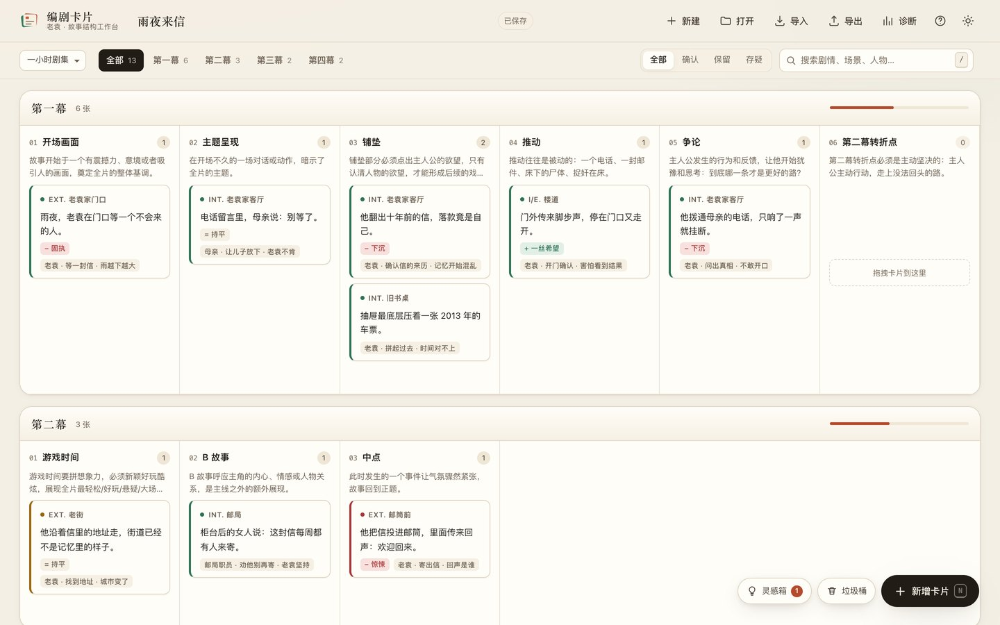
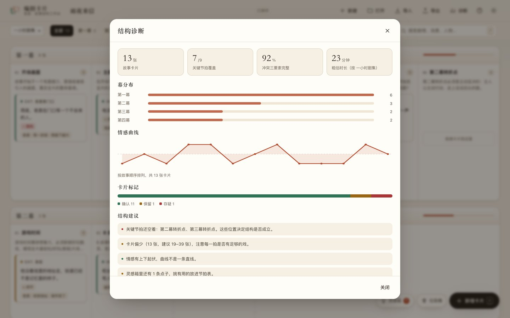
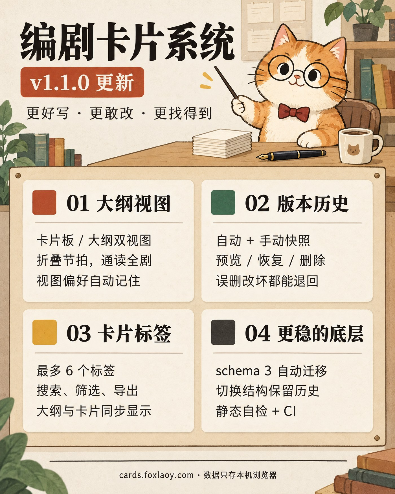

# 老袁编剧卡片系统

把故事结构摊在桌面上：按救猫咪节拍表 / 兔狲文化节拍表拆解剧本，一张卡片一场戏，拖拽调整顺序，随时诊断节奏。

纯静态、无构建、无后端。所有数据只存在你自己的浏览器里。





## v1.1.0 更新



- **大纲视图**：卡片板 / 大纲双视图，通读、折叠、筛选，视图偏好记住
- **版本历史**：自动 + 手动快照，预览、恢复、删除；误删改坏都能退回去
- **卡片标签**：最多 6 个，卡片、大纲、搜索、CSV / Markdown 全链路支持

## 在线使用

- 正式地址：**<https://cards.foxlaoy.com/>**
- Cloudflare Pages 源站：<https://cardwrite.pages.dev/>
- GitHub Pages 镜像：<https://foxmuldery.github.io/cardwrite/>

> ⚠️ 旧地址 `cards.laoyuanyingshi.com` 已于 2026-09 被劫持为垃圾站，**不要再使用，也不要在那里输入任何内容**。处理步骤见 [docs/DOMAIN.md](docs/DOMAIN.md)。

### 当前状态

| 项目 | 状态 |
| --- | --- |
| v1.0.0 代码 | 已合并到 `main` |
| 正式域名 | 已生效：<https://cards.foxlaoy.com/> |
| Cloudflare Pages | 已上线：<https://cardwrite.pages.dev/> |
| GitHub Pages | 同版本镜像：<https://foxmuldery.github.io/cardwrite/> |
| `cards.laoyuanyingshi.com` | 已失效，等待域名控制权恢复（与主站无关） |

## 功能

**结构**
- 三种剧本结构：电影（三幕 15 拍）、一小时剧集（四幕 15 拍）、半小时喜剧（三幕 15 拍）。
- 卡片板 / 大纲双视图：卡片板拖拽总览，大纲通读和改字；视图与折叠状态会记住。
- 每个节拍带推荐卡片数量与写作提示，超出建议数量会标黄。
- 切换剧本类型不再清空数据：能对上的卡片留在原位，对不上的移入灵感箱。

**卡片**
- 场景（INT./EXT./I/E. + 地点）、剧情、冲突三要素（主人公 / 目标 / 障碍）、情感变化（上扬 / 下沉 / 持平 + 说明）。
- 三种标记：确认、保留、存疑；卡片左侧色条即时区分。
- 拖拽跨节拍、跨幕排序；手机上长按拖动，拖到屏幕下方垃圾桶删除。
- 卡片菜单：编辑、复制、更改位置、删除。
- 标签：逗号或空格分隔，最多 6 个；卡片、大纲、搜索、CSV/Markdown 导出都会带上。
- 删除进垃圾桶，保留 30 天，可随时恢复，也可撤销。
- 版本历史：结构性修改与保存自动留档（最多 60 个），支持预览、恢复、删除、手动存版本；存在 IndexedDB。

**写作辅助**
- 灵感箱：还没想好放哪里的点子先存起来，之后一键转成卡片。
- 结构诊断：关键节拍覆盖、冲突完整度、幕分布、情感曲线、粗估时长，以及具体可执行的修改建议。
- 搜索：剧情、地点、人物、目标、障碍、情感说明全文搜索；按幕、按标记筛选。
- 多项目：自动保存当前项目，重要版本「另存为」快照；新建 / 打开 / 导入前会自动备份当前项目。

**导出**
- JSON 项目备份（可再次导入，兼容 v0.8.x 数据）。
- Markdown 故事大纲。
- CSV 卡片表（Excel / 飞书表格可直接打开）。
- 打印 / PDF：按幕分页，自动隐藏界面元素。

**体验**
- 深色 / 浅色主题，跟随系统，可手动切换。
- PWA：可安装到桌面 / iPad 主屏，断网可用。
- 键盘快捷键：`N` 新建，`/` 搜索，`⌘/Ctrl+Z` 撤销，`⌘/Ctrl+S` 导出备份，`?` 帮助。
- 响应式：桌面多列、手机单列，触控目标不小于 36px。
- 无外部字体、无 CDN 依赖（SortableJS 已内置），首屏不请求第三方资源。

## 数据与隐私

- 存储位置：`localStorage`
  - `scriptCards`：当前打开项目的自动保存
  - `scriptCards_<名称>`：另存的项目快照
  - `cardwrite.trash`：垃圾桶
  - `cardwrite.theme`：主题偏好
- 不上传、不统计、不请求接口。清理浏览器数据 / 换设备 / 换浏览器都会丢失，请定期「导出 → 项目备份」。
- 旧版 v0.8.x 数据在首次打开时自动迁移，建议迁移后立刻导出一次备份。

## 本地运行

```bash
# 任意静态服务器均可
python3 -m http.server 8080
# 打开 http://localhost:8080/
```

直接双击 `index.html` 也能用，但 Service Worker 需要 `http(s)` 才会注册。

## 部署

仓库是纯静态站点，根目录即发布目录。

**Cloudflare Pages**（当前主站）

项目名 `cardwrite`，直接上传静态文件：

```bash
npx wrangler pages deploy dist --project-name cardwrite --branch main
```

`_headers` 已配置安全与缓存响应头（GitHub Pages 会忽略该文件）。

**GitHub Pages**（镜像）

Settings → Pages → Source 选择 `Deploy from a branch`，分支 `main`、目录 `/ (root)`。仓库根目录的 `.nojekyll` 已就位。

**自定义域名**

在 Cloudflare 的 `foxlaoy.com` 区域添加 `CNAME  cards → cardwrite.pages.dev`（代理开启），Pages 项目会自动校验并签发证书。不需要 GitHub 的 `CNAME` 文件。详见 [docs/DOMAIN.md](docs/DOMAIN.md)。

## 目录

```
index.html                 页面骨架、弹窗、图标 sprite
assets/app.css             全部样式（含深色、打印、响应式）
assets/app.js              应用逻辑（无依赖）
assets/vendor/sortable.min.js  SortableJS 1.15.0（MIT，已内置）
assets/icons/              应用图标与 favicon
manifest.webmanifest       PWA 清单
sw.js                      离线缓存
scripts/check.mjs          无依赖静态自检（CI 用）
.github/workflows/ci.yml   push / PR 跑自检
404.html                   404 回退页
docs/DOMAIN.md             域名被劫持的取证与修复步骤
```

## 数据格式

```json
{
  "project": { "id": "uuid", "title": "剧本名", "type": "movie", "lastSaved": "2026-10-22T…", "schema": 3 },
  "acts": {
    "1": { "opening": [ { "id": "…", "status": "confirmed", "location": { "type": "INT", "place": "…" },
                          "description": "…", "conflict": { "protagonist": "…", "goal": "…", "obstacle": "…" },
                          "emotionalChange": "positive", "emotionalChangeContent": "…",
                          "tags": ["雨夜", "信"] } ] },
    "bucket": { "ideas": [] }
  }
}
```

`type` 取值：`movie` / `tv-hour` / `tv-half`。导入时会校验结构、补齐缺省字段（含 `project.id`），并把无法归位的卡片放进灵感箱，不会静默丢弃。旧版 v0.8.x / schema 2 的文件可直接导入。

## 交接与规划

- [交接报告](docs/HANDOVER.md)：现状、架构、数据模型、部署运维、已知问题、交接清单
- [功能扩展策划方案](docs/ROADMAP.md)：写作流 → 故事工程 → AI → 协作 → 正文，含排期与验收
- [域名修复记录](docs/DOMAIN.md)：旧域名取证、迁移过程、DNS 与证书

## 致谢

- 节拍表方法：Blake Snyder《救猫咪》、兔狲文化节拍表。
- 拖拽排序：[SortableJS](https://github.com/SortableJS/Sortable)（MIT）。
